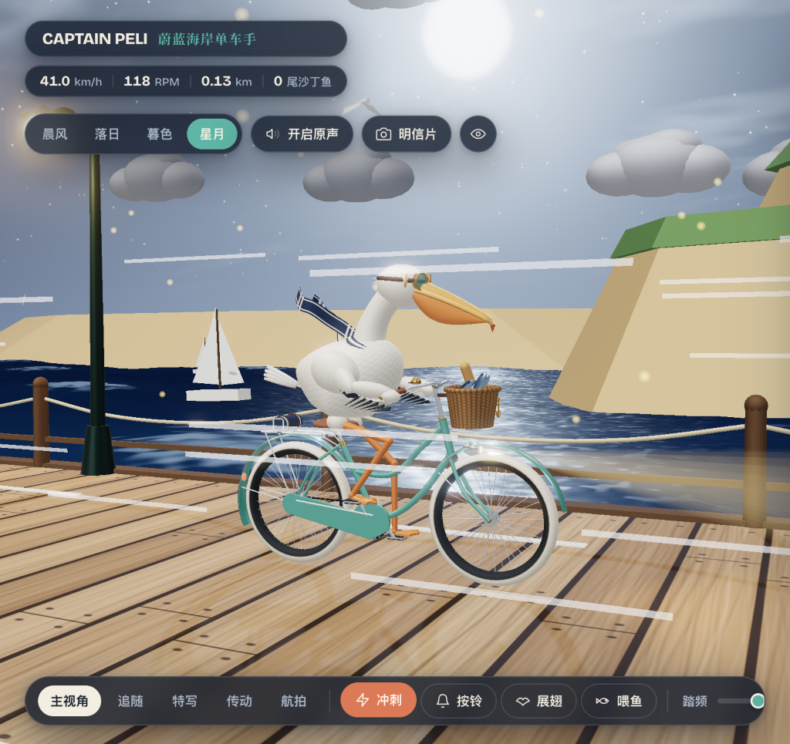
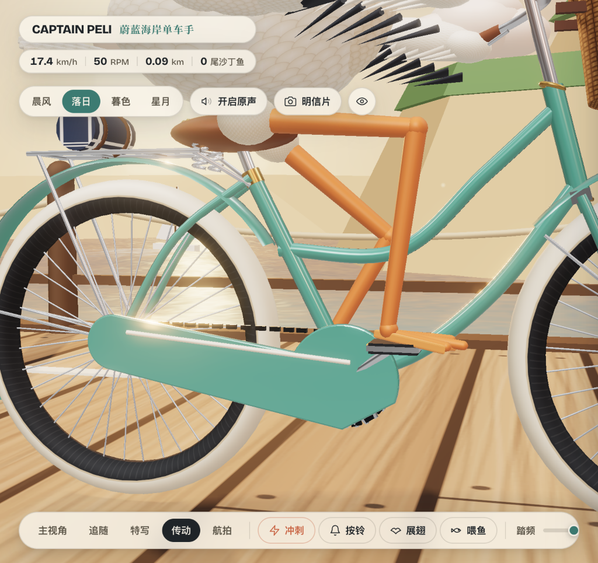
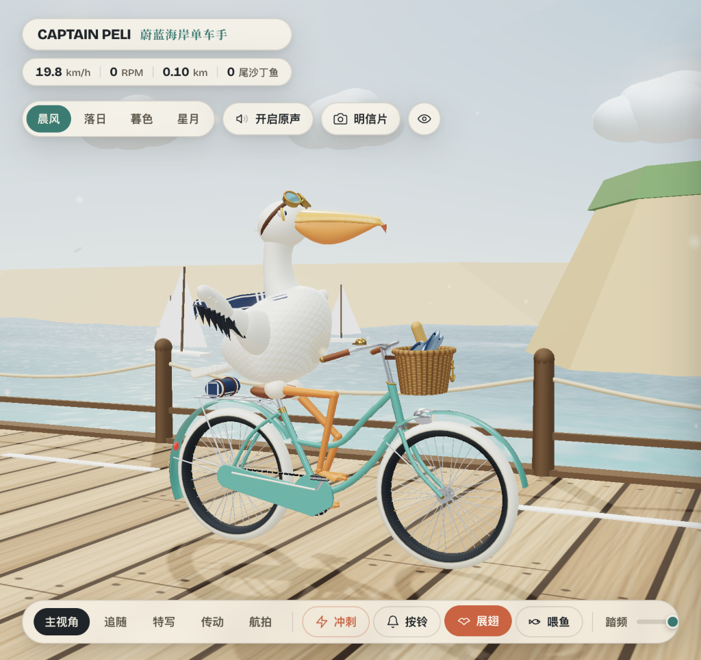
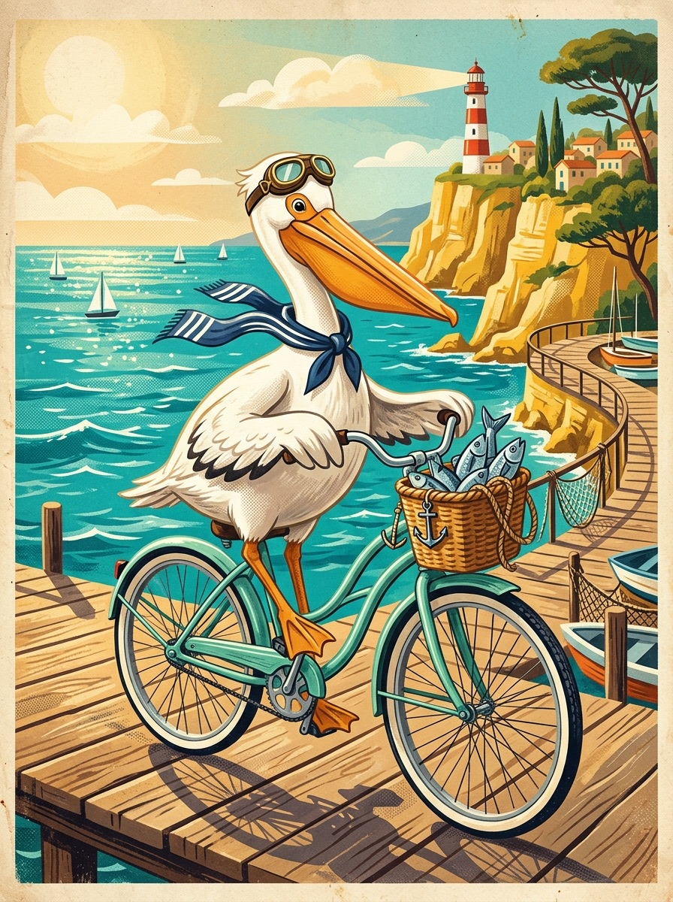

<h1 align="center">CAPTAIN PELI · 鹈鹕骑自行车 3D</h1>

<p align="center">
  <b>蔚蓝海岸木栈道实时 3D 互动体验 —— 程序化雕塑建模 · 2-Bone IK · 自定义 GLSL 着色器 · AI 多模态原声与海报</b>
  <br />
  参考 <a href="https://github.com/riba2534/claude-opus-5-5-demo">riba2534/claude-opus-5-5-demo</a> 的一句话实测挑战构建与开源。
</p>

<p align="center">
  
  
  
  
  
</p>

<p align="center">
  <a href="#在线体验">在线体验</a> ·
  <a href="#提示词原文">提示词原文</a> ·
  <a href="#画面预览">画面预览</a> ·
  <a href="#核心能力与技术实现">核心能力</a> ·
  <a href="#操作指南">操作指南</a> ·
  <a href="#本地运行与部署到-cloudflare">部署指南</a> ·
  <a href="#仓库结构">仓库结构</a>
</p>

---

## 在线体验

- **当前公开预览（Fastly CDN）**：https://yanzenxuan-star.github.io/pelican-bicycle-3d/
- **Cloudflare 独立域名 / `*.pages.dev` 部署**：仓库已完成 Vite 静态打包配置（构建命令 `npm run build`，输出目录 `dist`），可一键接入 Cloudflare Pages 或 Cloudflare Workers Static Assets 获取独立公网域名。

## 提示词原文

> 生成一个鹈鹕骑自行车的 3D 页面，尽可能把你所有的能力全部都用上. 然后上传到 CDN 上, 把访问链接给我

## 画面预览

<table>
  <tr>
    <td width="50%">
      
      <p align="center"><b>星月海岸 + 护目镜翻下全速冲刺</b></p>
    </td>
    <td width="50%">
      
      <p align="center"><b>双骨解析 IK 脚蹼踩踏 + 48 节实时运动链条</b></p>
    </td>
  </tr>
  <tr>
    <td width="50%">
      
      <p align="center"><b>晨风蔚蓝 + 双手撒把迎风展翅滑行</b></p>
    </td>
    <td width="50%">
      
      <p align="center"><b>AI 复古旅行海报（同款陈列于 3D 栈道画架与明信片工坊）</b></p>
    </td>
  </tr>
</table>

## 核心能力与技术实现

| 维度 | 实现细节 |
| --- | --- |
| **鹈鹕角色与物理动画** | 自定义程序化羽毛质感雕塑、**双骨解析逆运动学（2-Bone IK）**脚蹼严格锁定旋转脚踏、阻尼弹簧物理弹性喉囊、风速驱动水手条纹围巾布料波动、双翼「握把 ↔ 展翅」平滑混合、冲刺自动翻下黄铜飞行护目镜、自然眨眼与微表情 |
| **复古巡航单车机械** | 36 根交叉辐条与奶油边胎、真实舵管前叉转向联动、沿大小齿盘外公切线闭环运行的 48 节实时链条、带双螺旋弹簧的复古皮鞍座、装满银色沙丁鱼与法棍的藤编车筐、可点击击打的黄铜车铃、夜间自动点亮的子弹头车灯与体积光锥 |
| **自定义 GLSL 着色器** | 多层 Gerstner 波浪地中海海洋着色器（菲涅尔天空反射、浅滩翡翠渐变、日/月光带高光闪烁、岸边碎浪泡沫）+ Rayleigh/Mie 散射天空穹顶（动态卷云与星月闪烁星空） |
| **四时辰光影与无限世界** | `晨风 / 落日 / 暮色 / 星月` 平滑插值氛围系统；无限循环木栈道、球形复古路灯、摇曳棕榈树与三角梅、远方悬崖红白条纹灯塔与旋转光束、帆船与盘旋海鸥、实时 Bloom 后处理与 PMREM 环境反射 |
| **多模态 AI + 实时拟音** | MiniMax AI 原创 36 秒地中海手风琴/吉他循环主题配乐 + 4 条鹈鹕船长中文语音（带自动 Ducking 避让）+ Web Audio 实时合成海浪、风声、FM 黄铜车铃、棘轮空转声与吞鱼音效 |
| **交互与明信片工坊** | 3D 射线直点车铃 / 鱼筐 / 鹈鹕嘴 / 翅膀互动；5 组电影级机位视角；一键捕获实时 WebGL 画布合成带海岸邮戳的高清复古明信片 PNG 下载 |

## 操作指南

| 操作 | 效果 |
| --- | --- |
| **鼠标拖拽 / 滚轮** | 360° 自由环绕观察与缩放 |
| **直接点击 3D 部位** | 点击黄铜车铃按铃、点击鱼筐/大嘴抛鱼喂食、点击翅膀撒把展翅 |
| `Space` | 拉下黄铜飞行护目镜，全速冲刺（带速度线与动态 FOV） |
| `A / D` 或 `← / →` | 沿海岸木栈道压弯转向 |
| `B` | 拨响黄铜车铃并飘出音符 |
| `W` | 双手撒把迎风展翅滑行（触发棘轮空转声） |
| `F` | 从车筐抛起一条地中海沙丁鱼，触发喉囊弹性吞咽 |
| `1` – `5` | 切换机位：主视角 / 追随 / 特写 / 传动 IK / 航拍 |
| `M` / `P` / `H` | 开关 AI 原声配乐 / 打开明信片工坊 / 沉浸隐藏 UI |

## 本地运行与部署到 Cloudflare

### 本地开发与构建

```bash
npm install
npm run dev      # 本地开发 http://127.0.0.1:4173
npm run build    # 产出静态站点到 dist/
```

### 一键部署到 Cloudflare Pages（独立 `*.pages.dev` 或自定义域名）

1. 在 Cloudflare Dashboard 进入 **Workers & Pages → Create → Pages → Connect to Git**，选择本仓库 `pelican-bicycle-3d`。
2. 填写构建配置：
   - **Build command**：`npm run build`
   - **Build output directory**：`dist`
3. 点击部署即可获得全球边缘 CDN 独立访问地址（如 `https://pelican-bicycle-3d.pages.dev`），并可在 **Custom domains** 绑定自己的域名。

或使用命令行直接推送构建产物：

```bash
npm run build
npx wrangler pages deploy dist --project-name pelican-bicycle-3d
```

## 仓库结构

```text
pelican-bicycle-3d/
├── index.html                      # 入口页面与语义化 HUD 结构
├── vite.config.js                  # Vite 静态打包配置（base: './'）
├── public/assets/
│   ├── audio/                      # MiniMax AI 主题配乐与 4 条角色语音
│   └── images/riviera_poster.jpg   # AI 生成复古海岸旅行海报
└── src/
    ├── main.js                     # 渲染管线、Bloom 后处理、相机预设、射线交互与主循环
    ├── styles.css                  # 海岸自适应明暗界面样式
    ├── audio/soundEngine.js        # AI 音频混合与 Web Audio 实时拟音引擎
    ├── ui/hud.js                   # 仪表 HUD 与高清明信片合成下载工坊
    └── scene/
        ├── textures.js             # 程序化 PBR 木板 / 羽毛 / 藤编 / 轮胎 / 水手布纹理
        ├── moods.js                # 四时辰光照与雾效插值系统
        ├── bicycle.js              # 复古巡航单车、36 辐条轮组、48 节实时链条与车灯
        ├── pelican.js              # 鹈鹕船长雕塑、2-Bone IK、弹簧喉囊与围巾模拟
        ├── world.js                # 无限木栈道、悬崖红白灯塔、帆船与海鸥生态
        ├── effects.js              # 抛鱼抛物线、速度线、落羽、音符与萤火虫粒子
        └── shaders/
            ├── oceanShader.js      # 自定义 GLSL Gerstner 海浪与泡沫着色器
            └── skyShader.js        # 自定义 GLSL 大气散射与星空着色器
```

## License

[MIT](./LICENSE)
